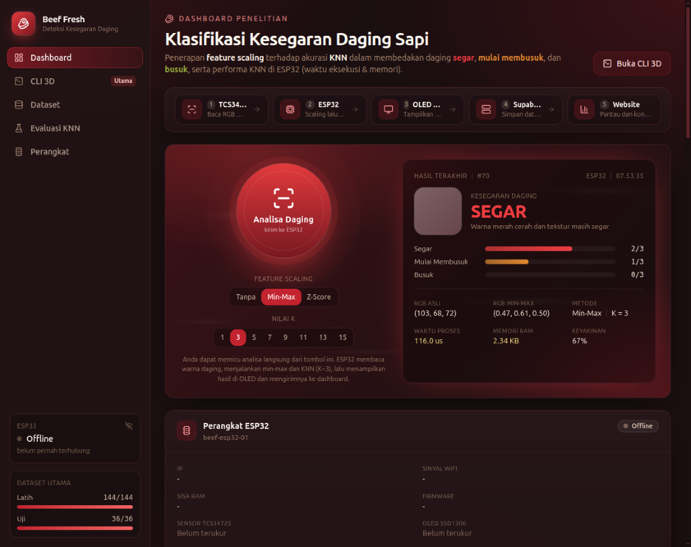
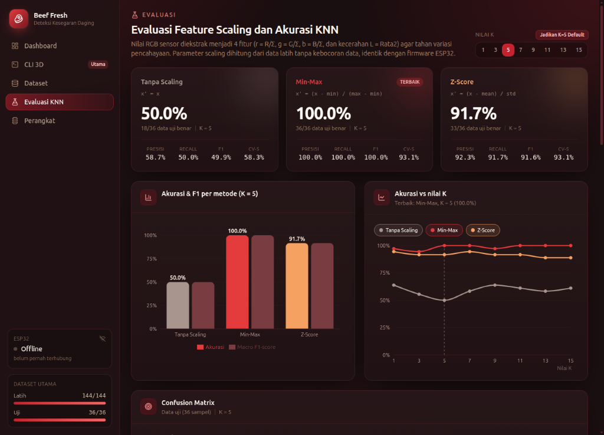
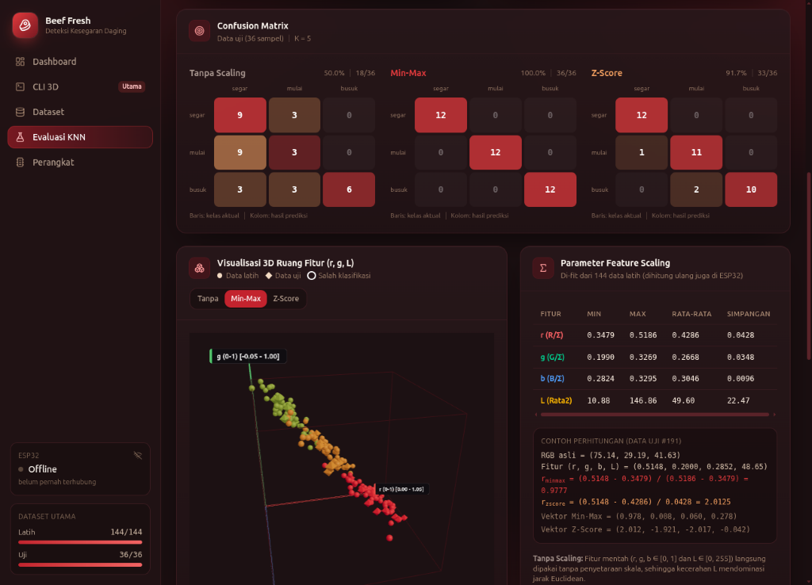
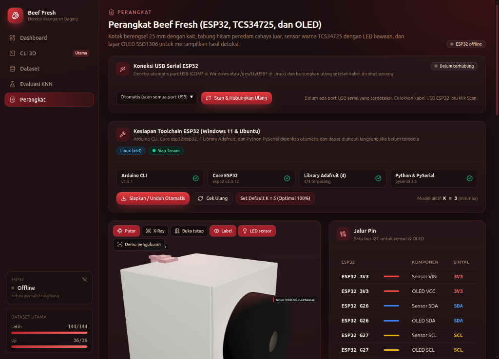
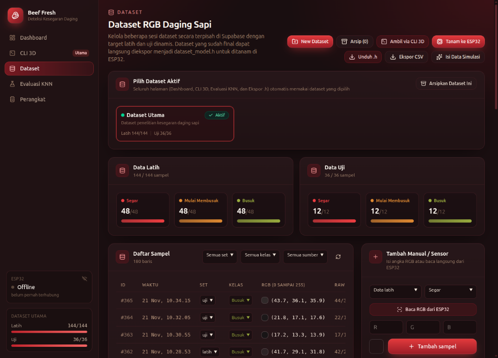
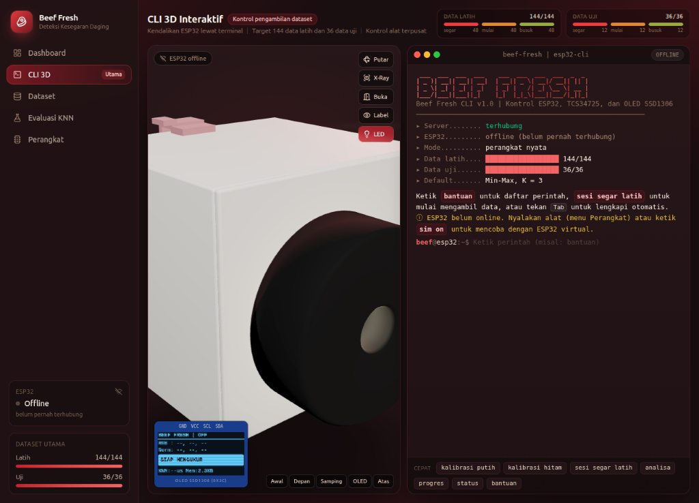

<div align="center">

# 🥩 Beef Fresh

**Sistem Klasifikasi Kesegaran Daging Sapi Berbasis Sensor Warna `TCS34725`, Feature Scaling, dan Algoritma KNN 4-Fitur `(r, g, b, L)` pada ESP32**

[](firmware/beef_fresh_esp32/beef_fresh_esp32.ino)
[](web/package.json)
[](supabase/web_schema.sql)
[](web/src/lib/server/toolchain.ts)
[-100.0%25%20(36%2F36)-16a34a?style=for-the-badge)](#3-hasil-evaluasi-model-144-latih--36-uji)

[Tampilan Website](#2-tampilan-website) · [Hasil Evaluasi](#3-hasil-evaluasi-model-144-latih--36-uji) · [Arsitektur & Hardware](#4-arsitektur-sistem--perangkat-keras) · [Struktur Proyek](#5-struktur-proyek) · [Instalasi & Menjalankan](#6-cara-instalasi--menjalankan)

<br />



</div>

---

## 1. Ringkasan Penelitian & Keunggulan Utama

**Beef Fresh** adalah sistem IoT dan *machine learning* terpadu untuk mengklasifikasikan tingkat kesegaran daging sapi (**Segar**, **Mulai Membusuk**, dan **Busuk**) secara *real-time* di mikrokontroler **ESP32**, sekaligus mengevaluasi dampak **Feature Scaling** (*Tanpa Scaling*, *Min-Max*, dan *Z-Score*) terhadap akurasi, waktu eksekusi (`µs`), dan konsumsi memori RAM ESP32.

- **Ekstraksi 4 Fitur Kromatisitas + Kecerahan `(r, g, b, L)`**: nilai RGB hasil kalibrasi 2-titik sensor `TCS34725` diekstrak menjadi rasio pigmen warna ternormalisasi $r = R/\Sigma$, $g = G/\Sigma$, $b = B/\Sigma$ ($\Sigma = R+G+B$) serta kecerahan rata-rata $L = \Sigma/3$. Pendekatan ini tahan terhadap variasi intensitas cahaya dan perbedaan kecerahan antar potongan daging.
- **Peringatan Permukaan Otomatis di OLED**: mendeteksi pembacaan yang mengenai lemak, membran putih, atau pantulan silau (`CEK: LEMAK / SILAU!`) maupun kondisi terlalu gelap (`CEK: TERLALU GELAP!`) secara *non-blocking*.
- **Paritas Penuh Web ↔ Firmware ESP32**: logika ekstraksi fitur, *Min-Max scaling*, jarak Euclidean 4D, dan *tie-break* KNN di [`web/src/lib/knn.ts`](web/src/lib/knn.ts) identik dengan implementasi C++ di [`firmware/beef_fresh_esp32/beef_fresh_esp32.ino`](firmware/beef_fresh_esp32/beef_fresh_esp32.ino).
- **Visualisasi 3D & CLI 3D Interaktif**: model 3D perangkat berbasis Three.js / React Three Fiber lengkap dengan fitur *X-Ray*, buka-tutup tuas, kontrol LED sensor, replika OLED langsung, dan plot sebaran fitur 3D `(r, g, L)`.
- **Auto-Provisioner Toolchain Lintas OS (Ubuntu 26.04 & Windows 11)**: halaman **Perangkat** dapat memeriksa sekaligus mengunduh otomatis `arduino-cli`, core `esp32:esp32`, 4 library Adafruit, dan Python `pyserial`, lalu langsung mengompilasi dan mem-flash `dataset_model.h` ke ESP32 via USB dalam 1 klik.

---

## 2. Tampilan Website

<table>
  <tr>
    <td width="50%" valign="top">
      <h4 align="center">Evaluasi Feature Scaling &amp; Akurasi KNN (<code>/evaluasi</code>)</h4>
      <a href="assets/screenshots/evaluasi.png">
        
      </a>
      <p>Perbandingan langsung metode <b>Tanpa Scaling</b>, <b>Min-Max</b> (<b>100.0%</b> pada <code>K=5</code>), dan <b>Z-Score</b>, lengkap dengan metrik presisi, recall, F1-score, 5-fold CV, grafik sweep nilai <code>K</code>, serta tombol simpan default <code>K</code> ke Supabase.</p>
    </td>
    <td width="50%" valign="top">
      <h4 align="center">Confusion Matrix &amp; Ruang Fitur 3D (<code>/evaluasi</code>)</h4>
      <a href="assets/screenshots/evaluasi-3d.png">
        
      </a>
      <p>Confusion matrix untuk seluruh metode scaling, visualisasi 3D interaktif ruang fitur <code>(r, g, L)</code> yang menandai data latih, data uji, dan salah klasifikasi, serta tabel parameter Min-Max/Z-Score beserta contoh perhitungan.</p>
    </td>
  </tr>
  <tr>
    <td width="50%" valign="top">
      <h4 align="center">Perangkat 3D, USB Serial &amp; Toolchain (<code>/perangkat</code>)</h4>
      <a href="assets/screenshots/perangkat.png">
        
      </a>
      <p>Deteksi otomatis port USB (<code>COM*</code> di Windows 11 / <code>/dev/ttyUSB*</code> di Ubuntu), pengecekan &amp; instalasi otomatis toolchain ESP32, kalibrasi 2-titik (Putih &amp; Hitam), model 3D <i>X-Ray</i>, tabel pinout I2C, dan tombol <b>Tanam ke ESP32</b>.</p>
    </td>
    <td width="50%" valign="top">
      <h4 align="center">Manajemen Dataset Multi-Sesi (<code>/dataset</code>)</h4>
      <a href="assets/screenshots/dataset.png">
        
      </a>
      <p>Pengelolaan sesi dataset di Supabase (kuota 144 data latih + 36 data uji), input sensor langsung atau manual, mode simulasi, ekspor CSV lengkap dengan fitur ternormalisasi, serta ekspor header C++ <code>dataset_model.h</code>.</p>
    </td>
  </tr>
  <tr>
    <td colspan="2" valign="top">
      <h4 align="center">CLI 3D Interaktif &amp; Replika OLED SSD1306 (<code>/cli</code>)</h4>
      <a href="assets/screenshots/cli3d.png">
        
      </a>
      <p align="center">Terminal interaktif berbasis web dengan kontrol model 3D secara langsung, replika layar OLED <code>128×64</code> secara <i>real-time</i>, perintah cepat akuisisi dataset (<code>sesi segar latih</code>), kalibrasi, benchmark perangkat, hingga mode simulasi virtual.</p>
    </td>
  </tr>
</table>

---

## 3. Hasil Evaluasi Model (144 Latih / 36 Uji)

Evaluasi menggunakan dataset utama pada [`firmware/beef_fresh_esp32/dataset_model.h`](firmware/beef_fresh_esp32/dataset_model.h) (**144 data latih**: 48 per kelas; **36 data uji**: 12 per kelas) dengan 4 fitur `(r, g, b, L)`:

| Metode Feature Scaling | Akurasi Uji `K=3` | Akurasi Uji `K=5` | Akurasi Uji `K=7` | Macro F1 (`K=5`) | 5-Fold CV (`K=5`) |
| :--- | :---: | :---: | :---: | :---: | :---: |
| **Tanpa Scaling** | `55.6%` | `50.0%` | `58.3%` | `49.9%` | `58.3%` |
| **Min-Max (0–1)** ⭐ | `94.4%` (`34/36`) | **`100.0%`** (`36/36`) | **`100.0%`** (`36/36`) | **`100.0%`** | **`93.1%`** |
| **Z-Score** | `91.7%` (`33/36`) | `91.7%` (`33/36`) | `94.4%` (`34/36`) | `91.6%` | **`93.1%`** |

> **Mengapa Feature Scaling sangat krusial pada 4 fitur `(r, g, b, L)`?**
> Rentang nilai kecerahan $L$ (`10.88 – 146.86`) ratusan kali lebih lebar dibandingkan kromatisitas $r, g, b$ (`0.20 – 0.52`). Tanpa scaling, $L$ mendominasi jarak Euclidean sehingga akurasi jatuh ke `50.0%`. Dengan **Min-Max Scaling**, keempat fitur memiliki bobot seimbang `[0, 1]` dan akurasi melonjak menjadi **`100.0%` (`36/36`)** pada `K=5`.

**Footprint Kompilasi ESP32 (`esp32:esp32:esp32`)**:
- **Program Storage (Flash)**: `962.052 bytes` (`73%` dari `1.310.720 bytes`)
- **Global Variables (RAM)**: `56.072 bytes` (`17%` dari `327.680 bytes`)

---

## 4. Arsitektur Sistem & Perangkat Keras

<table>
  <tr>
    <td width="58%" valign="top">
      <h4 align="center">Arsitektur Sistem 3-Lapisan</h4>
      
    </td>
    <td width="42%" valign="top">
      <h4 align="center">Desain Kepala Perangkat (3D)</h4>
      
    </td>
  </tr>
</table>

### Jalur Pin I2C (`ESP32` ↔ `TCS34725` ↔ `OLED SSD1306`)

| Pin ESP32 | Komponen Tujuan | Fungsi / Keterangan |
| :--- | :--- | :--- |
| **`3V3`** | Sensor `VIN` & OLED `VCC` | Catu daya `3.3 V` |
| **`GND`** | Sensor `GND` & OLED `GND` | Ground bersama |
| **`G26`** | Sensor `SDA` & OLED `SDA` | Jalur Data I2C bersama (`0x29` & `0x3C`) |
| **`G27`** | Sensor `SCL` & OLED `SCL` | Jalur Clock I2C bersama (`0x29` & `0x3C`) |
| **`G25`** *(opsional)* | Sensor `LED` | Kontrol nyala/mati LED bawaan TCS34725 dari website |

---

## 5. Struktur Proyek

```text
beef-fresh/
├── web/                                   # Aplikasi Web Next.js 16 + API & UI 3D
│   ├── src/
│   │   ├── app/                           # Halaman (/, /cli, /dataset, /evaluasi, /perangkat) & API routes
│   │   ├── components/                    # Dashboard, EvaluationView, DeviceView, DatasetManager, Three.js
│   │   ├── db/                            # Skema Drizzle ORM (PostgreSQL / Supabase)
│   │   └── lib/
│   │       ├── knn.ts                     # Ekstraksi 4 fitur (r, g, b, L), scaler, KNN, & deteksi lemak
│   │       └── server/
│   │           ├── toolchain.ts           # Auto-checker & auto-installer Arduino CLI / ESP32 / Lib / PySerial
│   │           ├── serial.ts              # Bridge USB Serial lintas OS (Windows COM* & Linux ttyUSB*)
│   │           ├── header-gen.ts          # Generator dataset_model.h otomatis dari database aktif
│   │           └── process.ts             # Pemroses hasil & simulator ESP32 virtual
│   ├── firmware/beef_fresh_esp32/         # Varian firmware polling WiFi/HTTPS
│   └── public/firmware/                   # Salinan firmware siap unduh dari halaman /perangkat
├── firmware/beef_fresh_esp32/             # Firmware utama ESP32 (USB Serial + NVS 2-Point Calibration)
│   ├── beef_fresh_esp32.ino
│   └── dataset_model.h                    # 144 data latih, 36 data uji, KNN_K=5, batas Min-Max 4 fitur
├── cli/
│   ├── serial_daemon.py                   # Daemon serial persisten (anti auto-reset & pelepasan port COM)
│   └── beef_fresh_cli.py                  # CLI Python interaktif
├── supabase/                              # Skema SQL PostgreSQL untuk Supabase
└── assets/                                # Diagram arsitektur, render perangkat 3D, & tangkapan layar web
```

---

## 6. Cara Instalasi & Menjalankan

### Prasyarat
- **Node.js** `>= 20` & **npm**
- **Python 3** (untuk komunikasi live USB Serial dengan ESP32)
- Driver USB-UART ESP32 (**CP210x** atau **CH340**) khusus pengguna **Windows 11**, atau pastikan user masuk grup `dialout` pada **Ubuntu** (`sudo usermod -aG dialout $USER`)
- File `.env` di root proyek berisi `DATABASE_URL` (PostgreSQL / Supabase)

> **Catatan Toolchain ESP32:** Anda **tidak perlu** memasang Arduino IDE secara manual. `arduino-cli`, core `esp32:esp32`, 4 library Adafruit (`Adafruit BusIO`, `Adafruit GFX Library`, `Adafruit SSD1306`, `Adafruit TCS34725`), dan `pyserial` dapat dicek serta diunduh otomatis langsung dari halaman **`/perangkat`** melalui tombol **Siapkan / Unduh Otomatis** (tersimpan terisolasi di `.tools/`).

### Langkah Menjalankan (Ubuntu 26.04 & Windows 11)

```bash
# 1. Clone repositori
git clone https://github.com/zhou-shi/beef-fresh.git
cd beef-fresh

# 2. Siapkan .env di root proyek (isi DATABASE_URL Supabase jika memakai database cloud)
cp .env.example .env

# 3. Install dependensi & jalankan web
cd web
npm install
npm run build
npm run start
```

Untuk akses jaringan lokal atau **port forwarding** (misal lewat Cloudflare Tunnel atau VS Code Ports):

```bash
npm run start:public
```

Lalu buka **`http://localhost:3000`** di browser:
1. Buka menu **`/perangkat`** → klik **Siapkan / Unduh Otomatis** (bila ada komponen toolchain yang belum terpasang) → colokkan ESP32 via USB → klik **Scan & Hubungkan Ulang**.
2. Pastikan nilai default **`K = 5`** aktif (klik **Set Default K = 5** di `/perangkat` atau **Jadikan K=5 Default** di `/evaluasi`).
3. Klik **Tanam ke ESP32** untuk mengekspor `dataset_model.h`, mengompilasi, dan mengunggah firmware terbaru langsung ke papan ESP32.
